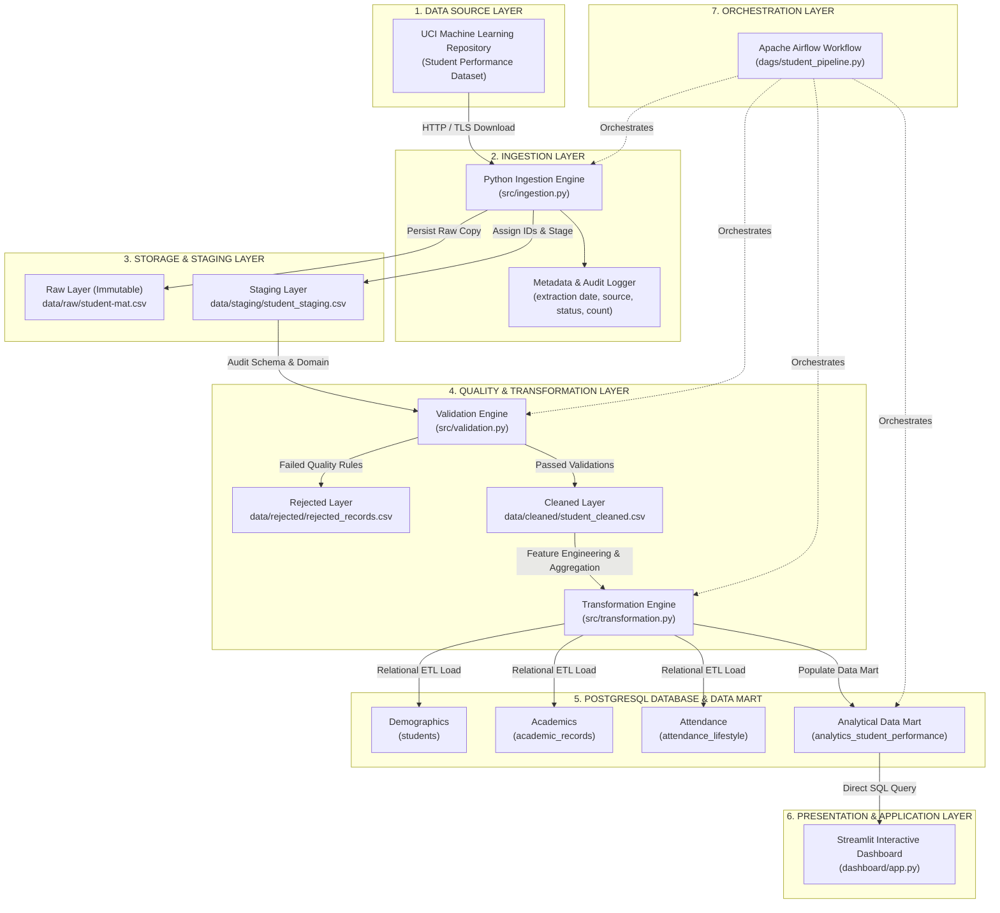

# System Architecture — Student Performance & Dropout-Risk Data Pipeline

## 1. High-Level Architecture Diagram

---

## 2. Layer-by-Layer Technical Specification

| Layer | Component | Implementation | Responsibility |
| :--- | :--- | :--- | :--- |
| **Source** | UCI Repository | Remote HTTP Endpoint | Original benchmark student data |
| **Ingestion** | `src/ingestion.py` | Python 3 + Pandas + Urllib | Download archive, unpack, record audit metadata without altering raw file |
| **Raw & Staging** | `data/raw/`, `data/staging/` | CSV + JSON | Immutable preservation of historical baseline + staged data with unique student keys |
| **Validation** | `src/validation.py` | Data Quality Rules Engine | Check duplicate students, numeric bounds (0-20 grades), category domains, and log errors |
| **Transformation** | `src/transformation.py` | Analytical Feature Generator | Derive attendance %, internal marks average, period progression trends, and dropout risk score |
| **Storage** | PostgreSQL / SQLite | Normalized Relational Schema | 3 normalized tables (`students`, `academic_records`, `attendance_lifestyle`) with strict constraints |
| **Analytics Mart** | `analytics_student_performance` | SQL Table + Views | Pre-aggregated flat data mart feeding dashboard views |
| **Dashboard** | `dashboard/app.py` | Streamlit + Plotly | 5 interactive views for cohort KPIs, risk drill-downs, and student profiles |
| **Orchestration** | `dags/student_pipeline.py` | Apache Airflow DAG | Automated sequential execution and dependency management |
