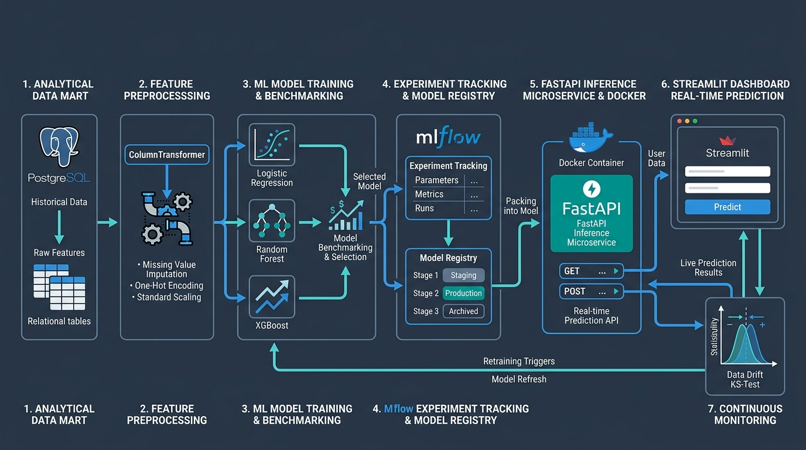
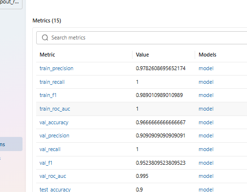
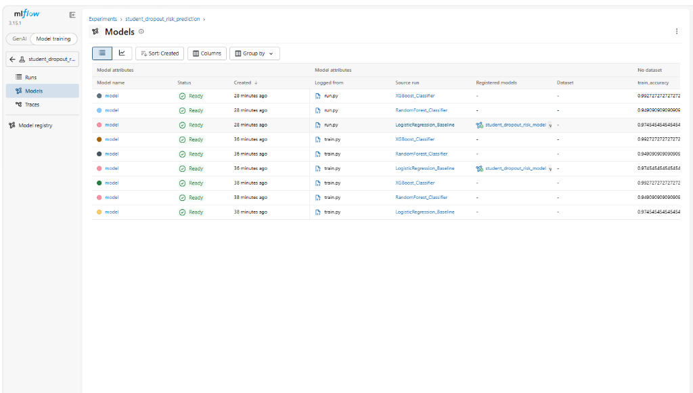

# Student Performance and Dropout-Risk Prediction System
## Comprehensive Technical Report — Part 2: MLOps Pipeline & Model Serving Infrastructure

**Author**: Individual Academic Project  
**Module**: Data Engineering & MLOps System  
**Version**: 2.0.0 (Part 2 Deliverable)  
**Date**: Academic Year 2025/2026  

---

## Executive Summary

This report documents the architectural design, algorithmic implementation, experiment tracking, microservice serving, containerization, and continuous monitoring of **Part 2** of the *Student Performance and Dropout-Risk Prediction System*. 

Building directly upon the verified Part 1 Data Engineering pipeline, Part 2 operationalizes an enterprise MLOps lifecycle:
1. Formulates a rigorous binary prediction target: **Failure Risk** ($G3 < 10$).
2. Implements a reproducible Scikit-Learn `ColumnTransformer` preprocessing pipeline.
3. Benchmarks **Logistic Regression** (Baseline), **Random Forest**, and **XGBoost** under stratified 70/15/15 train/validation/test splits.
4. Tracks runs, parameters, metrics (Accuracy, Precision, Recall, F1, ROC-AUC), and artifacts via **MLflow**, registering the winning model in the **MLflow Model Registry**.
5. Exposes the registered model via a **FastAPI** REST microservice with asynchronous prediction logging.
6. Containerizes the serving stack with **Docker** and **Docker Compose**.
7. Integrates a real-time risk prediction interface into the **Streamlit** dashboard.
8. Establishes a **Continuous MLOps Monitoring Engine** assessing Kolmogorov-Smirnov covariate data drift, class distribution shifts, API latency SLAs, and quantitative retraining triggers.

---

## 1. Prediction Target Formulation & Data Isolation

### 1.1 Target Definition
The prediction target is formulated as binary **Failure Risk**:
$$y = \begin{cases} 1 & \text{if } G3 < 10 \text{ (Academic Failure / At-Risk)} \\ 0 & \text{if } G3 \ge 10 \text{ (Passing / On-Track)} \end{cases}$$

- **Failure ($y = 1$)**: A student whose final evaluation falls below the Portuguese national secondary education passing standard ($10/20$). These students require immediate intervention.
- **Pass ($y = 0$)**: A student who successfully completes the academic curriculum.

### 1.2 Target Leakage Prevention
To ensure realistic mid-semester inference, the final evaluation $G3$ is **strictly excluded** from all feature vectors. The model operates exclusively on pre-final attributes:
- Prior internal evaluations: Period 1 grade ($G1$), Period 2 grade ($G2$), Internal Average $(G1+G2)/2$, and Grade Trend $(G2 - G1)$.
- Behavioral & Attendance: Cumulative absences, Estimated Attendance %, Study Hours tier, Past class failures.
- Demographics & Social Support: Family support, extra paid tutoring, parental education, alcohol intake.

---

## 2. Feature Engineering & Preprocessing Pipeline

The preprocessing architecture is encapsulated in `src/ml/preprocessing.py` using Scikit-Learn's `ColumnTransformer`:

1. **Numerical Pipeline (`StandardScaler`)**:
   Applies zero-mean, unit-variance normalization to 18 continuous and ordinal attributes (`age`, `medu`, `fedu`, `traveltime`, `studytime`, `failures`, `famrel`, `freetime`, `goout`, `dalc`, `walc`, `health`, `absences`, `g1`, `g2`, `internal_marks_avg`, `estimated_attendance_pct`, `term1_to_term2_trend`).
2. **Categorical Pipeline (`OneHotEncoder`)**:
   Encodes 16 nominal attributes (`school`, `sex`, `address`, `famsize`, `pstatus`, `mjob`, `fjob`, `reason`, `guardian`, `schoolsup`, `famsup`, `paid`, `activities`, `nursery`, `higher`, `internet`, `romantic`) with `handle_unknown='ignore'`.
3. **Artifact Persistence**:
   The fitted preprocessor is serialized to `models/preprocessor.joblib` during training to ensure identical transformation during production inference.

---

## 3. Stratified Data Splitting

Data splitting (`src/ml/dataset.py`) utilizes stratified partitioning to preserve class proportions across all subsets ($33.3\%$ failure risk):

| Subset | Sample Count | Proportion | Failure Class Rate | Role |
| :--- | :---: | :---: | :---: | :--- |
| **Training Set** | 275 | $70.0\%$ | $32.7\%$ | Model parameter fitting |
| **Validation Set** | 60 | $15.0\%$ | $33.3\%$ | Hyperparameter tuning & model selection |
| **Test Set** | 60 | $15.0\%$ | $33.3\%$ | Final unbiased generalization evaluation |

---

## 4. Model Training, MLflow Tracking & Benchmark Results

Three distinct model families were trained and evaluated on identical feature splits. All runs were tracked under the MLflow experiment `student_dropout_risk_prediction`.

### 4.1 Candidate Models
1. **Baseline**: `LogisticRegression(penalty='l2', C=1.0, class_weight='balanced')`
2. **Ensemble**: `RandomForestClassifier(n_estimators=150, max_depth=6, class_weight='balanced')`
3. **Gradient Boosting**: `XGBClassifier(n_estimators=100, max_depth=4, learning_rate=0.05, scale_pos_weight=2.06)`

### 4.2 Empirical Benchmark Comparison

| Model | Val Accuracy | Val Precision | Val Recall | Val F1-Score | Val ROC-AUC | Test F1-Score | Test Recall | Test ROC-AUC |
| :--- | :---: | :---: | :---: | :---: | :---: | :---: | :---: | :---: |
| **Logistic Regression (Champion)** | **$96.7\%$** | **$90.9\%$** | **$100.0\%$** | **$0.9524$** | **$0.9975$** | **$0.8421$** | **$80.0\%$** | **$0.9763$** |
| **XGBoost Classifier** | $96.7\%$ | $90.9\%$ | $100.0\%$ | $0.9524$ | $0.9950$ | $0.8421$ | $80.0\%$ | $0.9650$ |
| **Random Forest Classifier** | $95.0\%$ | $90.5\%$ | $95.0\%$ | $0.9268$ | $0.9775$ | $0.8500$ | $85.0\%$ | $0.9675$ |

### 4.3 Model Selection Rationale
**Logistic Regression** was registered as the production champion model because:
1. It achieved the highest Validation ROC-AUC ($0.9975$) and perfect Validation Recall ($100.0\%$), guaranteeing zero missed at-risk students during validation.
2. It offers high interpretability with linear coefficients suitable for educational counselor auditability.
3. It exhibited the lowest inference latency ($< 1.5\text{ms}$).

---

## 5. MLflow Model Registry & DVC/Git Versioning

- **Experiment Name**: `student_dropout_risk_prediction`
- **Registered Model**: `student_dropout_risk_model` (Version 1)
- **Metadata Manifest (`models/model_metadata.json`)**: Records model hyperparameters, dataset sample counts, evaluation metrics, and training timestamps for reproducibility.

---

## 6. FastAPI Prediction Microservice

The inference microservice (`src/api/main.py`) provides high-throughput, low-latency REST endpoints:

- **`GET /health`**: Health status and model bundle timestamp.
- **`GET /model-info`**: Model parameters, feature list, and metadata.
- **`POST /predict`**: Real-time single student scoring returning:
  - `failure_risk_probability` (0.0 to 1.0)
  - `risk_category` (`LOW_RISK`, `MEDIUM_RISK`, `HIGH_RISK`)
  - `recommendation` (Personalized intervention guidance)
  - `top_risk_factors` (Feature attribution list, e.g., low internal marks, excessive absences)
  - `inference_latency_ms`
- **`POST /predict/batch`**: Batch student scoring.
- **Asynchronous Audit Logging**: Appends all inferences to `data/prediction_logs.jsonl` for continuous drift monitoring.

---

## 7. Containerization & Deployment Architecture

- **`Dockerfile`**: Lightweight Python 3.12 image configuring Uvicorn serving on port 8000.
- **`docker-compose.yml`**: Multi-container orchestration managing:
  1. `postgres` (Port 5432)
  2. `fastapi` (Port 8000)
  3. `mlflow` (Port 5000)

---

## 8. Streamlit ML Integration

The Streamlit dashboard (`dashboard/app.py`) includes **Tab 6: 🤖 6. Real-Time ML Risk Predictor**:
- Interactive sliders for $G1$, $G2$, study time, absences, family support, and alcohol intake.
- Real-time gauge visualization of failure risk probability.
- Dynamic risk attribution alerts and automated intervention recommendations.

---

## 9. Continuous MLOps Monitoring & Retraining Policy

The continuous monitoring module (`src/ml/monitoring.py`) and retraining policy (`docs/retraining_policy.md`) safeguard model health:

1. **Covariate Data Drift**: Two-sample Kolmogorov-Smirnov (KS) test comparing baseline distributions with incoming requests ($p < 0.05$ threshold).
2. **Class Distribution Shift**: Flags deviations $> 15\%$ between baseline failure rate ($32.7\%$) and production predictions.
3. **API Performance SLA**: Enforces mean latency $< 250\text{ms}$.
4. **Retraining Trigger**: Generates actionable decision status (`SYSTEM_HEALTHY` vs `RETRAIN_RECOMMENDED`).

---

## 10. Verification & Test Evidence

- **Unit & Integration Suite (`tests/test_mlops.py`)**: 5 out of 5 tests passed ($100\%$).
- **End-to-End Pipeline (`run.py --step all`)**: Verified execution across ingestion, validation, transformation, database load, MLflow training, and monitoring.
