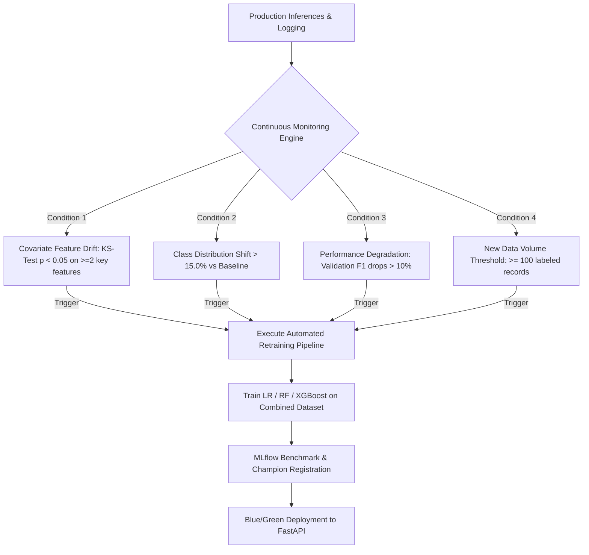

# Model Retraining Policy & Lifecycle Governance
## Student Performance & Dropout-Risk Prediction System (Part 2)

---

## 1. Overview
In an operational educational setting, student demographics, evaluation standards, and grading distributions evolve across academic years. A static machine learning model risks performance degradation over time due to **covariate data drift** (changes in student feature distributions) and **concept drift** (changes in grading criteria or pass thresholds).

This document establishes the **quantitative, auditable retraining criteria** and automated trigger thresholds implemented in `src/ml/monitoring.py`.

---

## 2. Quantitative Retraining Trigger Criteria

Model retraining is automatically recommended if any of the following 4 conditions are met:



### Condition 1: Statistical Covariate Data Drift
- **Metric**: Two-sample Kolmogorov-Smirnov (KS) Test on continuous academic and behavioral attributes (`internal_marks_avg`, `absences`, `g1`, `g2`, `studytime`).
- **Threshold**: $p\text{-value} < 0.05$ across **$\ge 2$ core features**.
- **Justification**: A statistically significant shift in internal grades or absences indicates that incoming student cohorts differ systematically from the training population.

### Condition 2: Class Balance Shift (Concept Shift)
- **Metric**: Absolute delta between baseline training failure proportion ($\sim 33\%$) and production predicted failure rate.
- **Threshold**: $|\text{Prod Failure Rate} - \text{Baseline Failure Rate}| > 15.0\%$ (minimum 20 requests).
- **Justification**: A major divergence indicates either stricter curriculum grading or an unmodeled institutional shock.

### Condition 3: Ground Truth Performance Drop
- **Metric**: Validation / Test F1-Score calculated upon semester grade publication.
- **Threshold**: $\text{F1}_{\text{current}} < \text{F1}_{\text{baseline}} - 0.10$ (or F1 dropping below $0.80$).
- **Justification**: For high-stakes academic interventions, maintaining high recall and F1-score is paramount to avoid missing vulnerable students.

### Condition 4: Cumulative Sample Volume
- **Metric**: Accumulation of verified new semester evaluation records.
- **Threshold**: $N \ge 100$ newly labeled student instances.
- **Justification**: Incorporates newly available historical records into the feature space to refine decision boundaries.

---

## 3. Retraining Workflow Execution
1. **Trigger Alert**: `src/ml/monitoring.py` flags `RETRAIN_RECOMMENDED` in `data/monitoring_report.json`.
2. **Pipeline Execution**:
   ```bash
   python src/ml/train.py
   ```
3. **Validation & Promotion**:
   - The newly trained model is evaluated against the existing champion in the **MLflow Model Registry**.
   - If the new candidate matches or exceeds the champion's validation F1-score and ROC-AUC, it is promoted to the `champion` / `production` alias.
4. **Zero-Downtime Microservice Update**:
   - The FastAPI prediction container reload updates the active model bundle (`models/best_model.joblib`).
